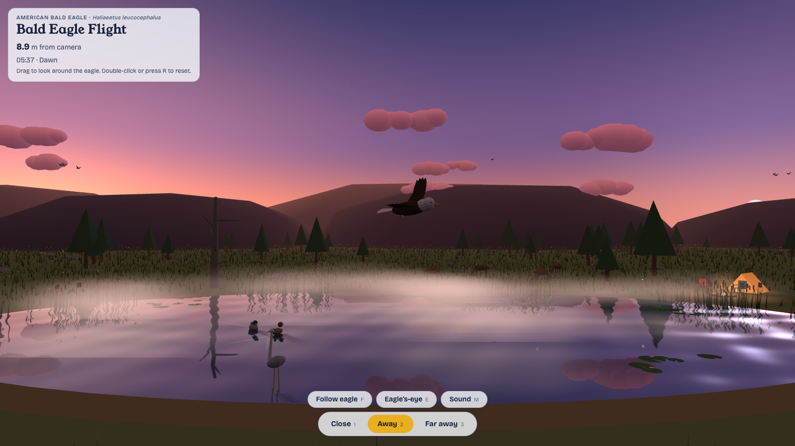

# Bald Eagle Flight

An animated 3D scene of an American bald eagle (*Haliaeetus leucocephalus*) over a lake. The day loops continuously, with weather, wildlife and a lakeside campsite. Everything lives in a single file, `bald-eagle-flight.html`, built with [three.js](https://threejs.org/) r128.

## Running it

Open `bald-eagle-flight.html` in a modern browser, either straight from disk or through any web server (for example `http://localhost/bald-eagle-flight.html`). There is no build step. The page loads three.js from cdnjs and its fonts from Google Fonts, so it needs an internet connection.

## Controls

| Control | Action |
| --- | --- |
| Drag (mouse or one finger) | Look around the eagle |
| Double-click / double-tap, or `R` | Reset the view |
| `1` / `2` / `3` | Camera distance: Close (3.2 m), Away (9 m) or Far away (30 m) |
| `F` | Follow the eagle on a tour of the whole landscape |
| `E` | Eagle's-eye view, riding just ahead of the beak |
| `M` | Sound on or off (off by default) |

The card in the top-left corner shows how far the eagle is from the camera, the time of day, the weather and when the northern lights are out.

## What's in the scene

### The eagle

- Built life size, with a wingspan of about 2.2 m. It has a dark brown body, a white head and tail, a hooked yellow beak and spread "finger" primaries.
- Flies with slow, deep wingbeats between long glides and banks into its turns.
- **Fishing:** it picks out one of the fish visible under the surface and dives on it. It skims the water with its talons forward, snatches the fish with a splash and carries it to a dead tree on the far-left shore. It eats there, dipping its head, then takes off again.
- **Storms:** it waits out thunderstorms perched on the dead tree.
- **Neighbours:** at night it swoops low over the fox twice and chases the owl round its circle. The deer bolt when it comes in low near them.

### Wildlife

- **Deer:** a herd of four, one of them a buck with antlers. They graze, look around, amble about and walk down to the lake to drink. They keep a wary eye on the fox.
- **Mallards:** three ducks paddling about the lake, each trailing a faint wake. The lily pads bob as they pass.
- **Fish:** dark shapes cruise just under the surface, and now and then one leaps clear of the water.
- **Great blue heron:** wades the near-left shallows, freezes, then stabs at the water. It sometimes comes up with a fish and swallows it.
- **Red fox:** trots a loop behind the deer meadow from dusk to dawn, stopping to sniff. It bolts when the eagle buzzes it.
- **Great horned owl:** glides a slow circle among the trees after dark.
- **Bats:** flit low over the lake from dusk into the early night.
- **Distant birds:** small flocks in V formation cross the sky.

### The campsite

A man and a woman are camping on the right-hand shore. Their camp has an orange ridge tent, two folding chairs and a stone fire pit.

- **By day:** they sit in their chairs or wander around the tent and fire pit. When the eagle passes close overhead, they stop and point at it, following it with their heads. If they're sitting, they twist round in the chair to point. The eagle comes close most often in the Far away and Follow views.
- **Rain:** they go into the tent when it starts raining and come back out when it clears.
- **Night:** from 21:00 until sunrise they're in the tent. A lamp lights it from inside and the fire burns outside, throwing sparks and a warm glow on the ground.

### Day and night

- The sun rises at 06:00 behind the left hills and sets at 20:00 behind the right hills. Daylight lasts about 70 seconds and a full day about a minute and a half. The page opens at 05:36, just before dawn.
- The sky shifts through pre-dawn, pink dawn, blue midday, golden dusk and deep night.
- At dawn, mist hangs over the lake and burns off as the sun climbs. By day, sunbeams slant down from the clouds and cloud shadows drift across the land.
- At night, stars come out along with shooting stars and fireflies. The moon moves through its phases over eight days. The northern lights appear on the first night and on about half of the nights after, behind the starting view.

### Weather

- Long clear spells, now and then clouding over into light rain or a thunderstorm.
- Rain falls in slanting streaks and makes rings on the lake. The grass and trees sway harder in the wind.
- Lightning strikes whenever it rains and most often in a thunderstorm. Each strike is a forked bolt with a double flash across the sky, followed by thunder.
- A rainbow appears as the rain clears.

### Landscape

- A lake that reflects the sky and scenery, broken up by moving ripples. The sun and moon glint on the water.
- A meadow of around 41,000 grass blades and 4,500 wildflowers, with reeds and cattails along the shore.
- Trees, boulders and hills all round, so there's scenery whichever way you look. The layout is generated from a fixed seed, so it's the same on every load.

### Sound

All sound is generated in the browser with the Web Audio API; there are no audio files.

- **Wind and rain:** wind blows all the time, louder in bad weather, with a rain hiss whenever it rains.
- **Day and night:** birdsong while the sun is up and it's dry. After dark there are crickets, frogs and the owl's hoot.
- **Events:** the eagle's high chatter when it dives or gives chase, and splashes from catches, leaping fish and the heron. Thunder follows lightning after a delay that's longer for distant strikes.

## Accessibility

- When the system's reduced-motion setting is on, the animation runs at half speed.
- The canvas has a text description of the scene for screen readers.
